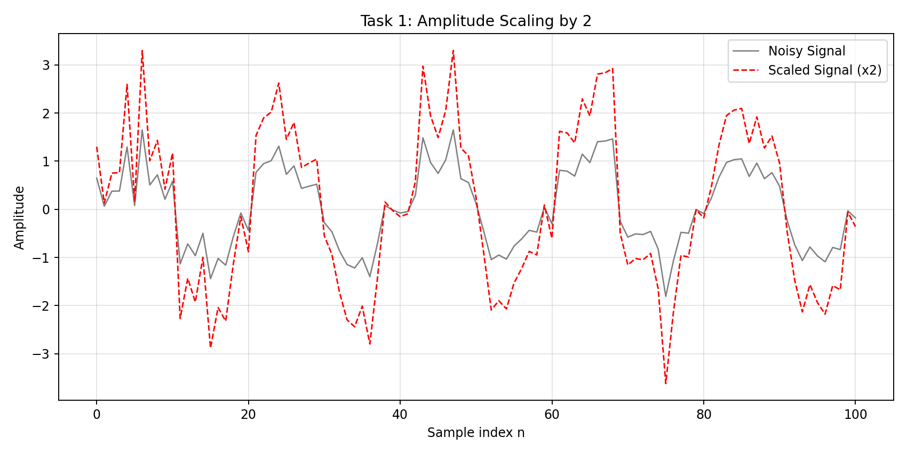
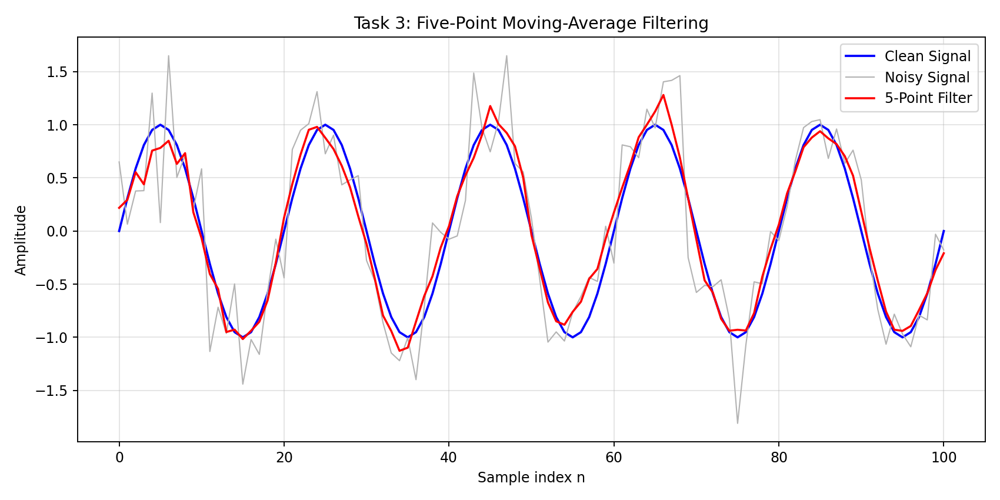
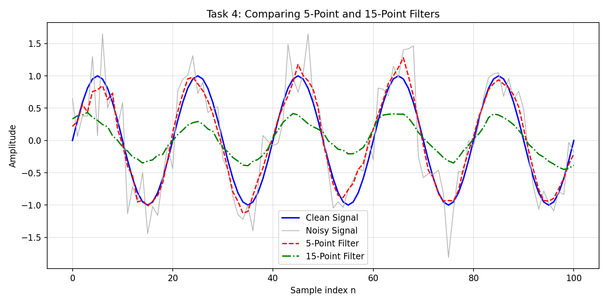

# Lecture 03: Discrete-Time Signal Operations and Convolution

## Overview

This MATLAB exercise creates a sine wave, adds random noise, multiplies its amplitude, delays it, and applies 5-point and 15-point moving-average filters using convolution. The signal contains 101 samples, indexed from 0 to 100. `rng(1)` fixes MATLAB's random-number sequence so the plots can be reproduced when the script is rerun in MATLAB.

## How to run

Open MATLAB, change the Current Folder to `Lecture03`, and run:

```bash
Lecture03_convolution
```

The script creates three required PNG files in the current folder: `signal_operations.png`, `noise_filtering.png`, and `filter_comparison.png`. It also displays the original-versus-noisy plot and the delay plot in separate figures.

## Figures

### Task 1: Amplitude scaling



### Task 3: Five-point moving-average filter



### Task 4: Filter comparison



## Answers to README questions

**1. Which operation changed the signal amplitude?**

Amplitude scaling changed it. I multiplied each measured sample by 2 (`scaled = 2*measured`). In the amplitude-scaling plot, the red curve has twice the height (positive and negative) of the gray curve at the same sample indices. The frequency and sample positions do not change.

**2. How did the five-sample delay change the signal?**

I placed five zeros before the noisy signal (`delayed = [zeros(1,5), measured]`). Every original sample appears five sample positions later, so the signal moves to the right. Its values and shape stay the same, but its length increases from 101 to 106 samples. A delay can occur in a sensor, communication system, or processing chain.

**3. What does the impulse response `h[n]` represent?**

The impulse response describes a filter's output when its input is one unit impulse. It also tells us the filter's weights. For the 5-point moving-average filter, the five weights are each `1/5`, so neighboring samples contribute equally to the average. For the 15-point filter, all fifteen weights are `1/15`.

**4. How did convolution change the noisy signal?**

`conv(measured,h5,'same')` combines nearby values using the averaging weights. In the five-point filter plot, the red filtered signal has fewer sharp random jumps than the gray noisy signal and follows the blue clean sine wave more closely over much of the range. The `'same'` option produces 101 output samples. Near the ends, convolution's implicit zero padding can affect the filtered values.

**5. What differences did you observe between the 5-point and 15-point filters?**

The 5-point result stays closer to the original sine wave's peaks and valleys. The 15-point result is smoother, but its oscillations are noticeably smaller. In the comparison plot, the 15-point curve is flatter around the peaks because it averages samples over a larger part of the sine wave.

**6. Which filter removed more noise?**

The 15-point filter suppresses more fast sample-to-sample variation, because it averages a larger number of noisy samples. However, a smoother-looking output does not necessarily mean it is closer to the original clean signal overall.

**7. Did the longer filter remove or distort useful signal information?**

Yes. The clean sine wave has a period of 20 samples, so a 15-point averaging window is large compared with one cycle. It averages together values from very different parts of a cycle, reducing the useful sine-wave amplitude as well as suppressing noise.

**8. Which filter would you recommend for this signal? Explain your decision.**

I recommend the 5-point filter for this particular sine wave. It reduces the random spikes without flattening the wanted sine-wave oscillations as much as the 15-point filter. This is a compromise between noise reduction and keeping the signal shape. The script also prints mean squared error (MSE) against the known clean wave for a numerical check; smaller MSE indicates a closer match in this experiment.

**9. Give one real engineering application for moving-average filtering.**

A temperature monitoring system can average several consecutive sensor readings to reduce random measurement fluctuations. This makes the displayed temperature more stable, although a very long averaging window would react more slowly to actual temperature changes.

## MATLAB commands explained

- `rng(1)` makes the simulated noise reproducible.
- `randn(size(n))` generates random noise samples.
- `zeros(1,delay)` creates leading zeros for a delay.
- `ones(1,5)/5` defines five equal averaging weights.
- `conv(x,h,'same')` filters `x` with the impulse response `h` and retains the input length.
- `saveas(gcf,'filename.png')` writes the current plot as an image.

## AI Usage

**Tool used:** ChatGPT (OpenAI).

**How I used it:** Helped prepare MATLAB code, propose plot formatting, and draft explanations of scaling, delay, impulse response, and convolution.

**What I verified or changed:** Reviewed the formulas and figure labels, and checked equivalent filtering calculations and preview plots outside MATLAB. **MATLAB execution still needs to be checked locally:** run `Lecture03_convolution.m` in MATLAB, inspect the generated plots, and replace the preview PNGs with MATLAB's own outputs. Then revise these written observations in your own words to match what you see.
