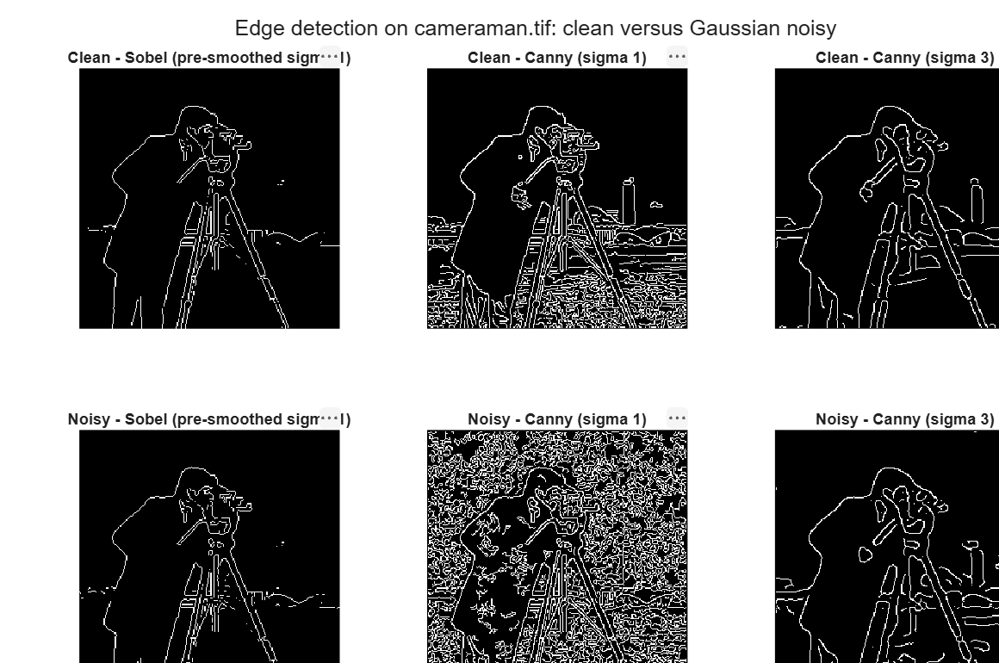

# Individual Assignment - Image Processing Fundamentals

## Selected option and question

**Option C - Compare edge detectors.** How do Sobel with prior Gaussian smoothing, Canny with sigma 1 and Canny with sigma 3 respond to clean and Gaussian-noisy versions of MATLAB's `cameraman.tif`?

## Data, method and reproducibility

- Image: MATLAB Image Processing Toolbox sample `cameraman.tif` (not redistributed).
- Noise: `rng(42); In = imnoise(I,'gaussian',0,0.01);` (Gaussian variance 0.01).
- Sobel: `edge(imgaussfilt(image,1),'Sobel')`.
- Canny sigma 1: `edge(image,'Canny',[],1)`.
- Canny sigma 3: `edge(image,'Canny',[],3)`.
- All six edge maps use MATLAB's default thresholds; count = `nnz(edgeMap)`.
- MATLAB version used for the supplied executed results: **26.2.0.3468271 (R2026b) Update 2**.
- Image Processing Toolbox: **available** (`license('test','image_toolbox')` returned 1).

## Verified results

These counts were transcribed from the **executed MATLAB output in the supplied `analysis.pdf`, page 2**. The included CSV is a transcription, not a claim that this revised script has been re-executed.

| Detector | Clean edge pixels | Noisy edge pixels | Noisy - clean |
|---|---:|---:|---:|
| Sobel, pre-smoothed sigma 1 | 2,099 | 2,026 | -73 |
| Canny, sigma 1 | 7,816 | 18,112 | +10,296 |
| Canny, sigma 3 | 2,780 | 3,184 | +404 |

The screenshot image above is a **crop of the original MATLAB figure**, not a substitute for the full-resolution `six_edge_maps.png` that the script generates when rerun.

## Interpretation and observed region

The noisy Canny sigma 1 edge map shows many additional short edges in textured and otherwise comparatively smooth areas around the photographer and camera. This is consistent with the increase from 7,816 to 18,112 detected edge pixels. Stronger Canny smoothing (sigma 3) greatly reduces these responses (3,184 noisy edge pixels), while retaining the broad person, camera, and tripod boundaries. The trade-off is that some finer camera/tripod structures visible with sigma 1 are weakened or missing with sigma 3. In the selected region (rows 80:160, columns 100:180), there are numerous fragmented responses around camera details in sigma 1; sigma 3 retains fewer, smoother outlines and loses some weak small details.

Sobel with Gaussian pre-smoothing shows fewer detected edge pixels and a comparatively clean main outline. The noisy Sobel count is slightly lower than the clean count, which **does not prove better correctness**; weak real edges can be missed.

**Preference for this image:** Canny sigma 3 when broad, noise-resistant outlines matter more than fine texture. For small details, Canny sigma 1 can be useful on cleaner images.

**Limitation:** The edge-pixel count cannot tell real boundaries from false detections. There is no labelled ground truth for precision/recall; method thresholds are selected automatically and can also affect the comparison.

## Files and how to run

1. In MATLAB Online open the `Image-Processing-Fundamentals-Option-C` folder as your **Current Folder**.
2. Open `analysis.m`, then use **Save As > Live Script** to create `analysis.mlx`. Do not merely rename the extension.
3. **Run all** in the Live Editor. Results will be written to `pwd/results/`, not the Live Editor temporary cache.
4. Confirm six image maps, the regional comparison, and `edge_pixel_counts.csv`; compare regenerated values with the table above.
5. Save the **executed** `analysis.mlx` and use **Export > PDF** for a fresh `analysis.pdf`. An appendix has been added to the supplied earlier PDF, but a freshly exported PDF is best for a final submission.
6. Commit `analysis.mlx`, `analysis.pdf`, `README.md`, `results/` and optionally `analysis.m` inside your existing DSP repository as ordinary files, not as a nested Git repository.

The included `results/six_edge_maps_reference.png` is visual evidence cropped from the earlier MATLAB screenshot. Full resolution figure files are produced by the script after you run it.

## AI assistance

ChatGPT helped organize and revise MATLAB code, transcribe the observed MATLAB results, and draft the explanatory documentation. The numerical counts above came from the executed MATLAB PDF, not an AI simulation. The revised script has not been re-run in MATLAB by ChatGPT; any final regenerated files must be checked by the student. This project uses no AI method for its edge detection.
