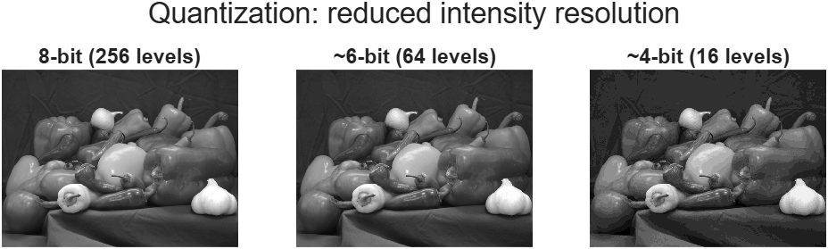
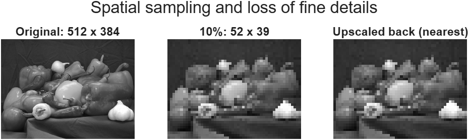

# Lab 1 — Image as a 2D Signal

## Objective

Investigate an image as a two-dimensional signal by studying **quantization (bit-depth)**, **dynamic range and contrast**, **histograms**, **nonlinear gamma correction**, and **spatial sampling** in MATLAB.

## Requirements

- MATLAB with **Image Processing Toolbox** (`rgb2gray`, `imshow`, `imhist`, `imadjust`, `mat2gray`, `imresize`).
- MATLAB sample image `peppers.png`, or `cameraman.tif` as the supplied fallback.
- If neither image is installed, upload an image and adapt the image-loading section.

## Run the experiment

1. Open `Lab1_image_2D_signal.m` in MATLAB Online.
2. Click **Run**.
3. Confirm the Command Window reports the source image, class, pixel range, and dimensions.
4. Check the six PNG figures saved alongside the script.
5. Download the generated figures and `image_measurements.txt` for GitHub submission.

## Repository structure

```text
Lab1-Image-as-2D-Signal/
├── Lab1_image_2D_signal.m
├── README.md
├── image_measurements.txt          # generated in MATLAB
├── 01_original_grayscale.png      # generated in MATLAB
├── 02_quantization.png            # generated in MATLAB
├── 03_histograms.png              # generated in MATLAB
├── 04_contrast_stretching.png      # generated in MATLAB
├── 05_gamma_correction.png        # generated in MATLAB
└── 06_sampling_resize.png         # generated in MATLAB
```

## Section 0 — Image inspection


- Image used: **[enter actual image filename from MATLAB output]**
- Class: **[enter MATLAB value]**
- Dimensions: **[enter MATLAB value]**
- Grayscale minimum / maximum: **[enter MATLAB values]**

**Explanation:** A grayscale image represents intensity at each pixel location (row, column). RGB stores three color channels; grayscale stores a single luminance-like intensity channel.

## Section 1 — Quantization and bit-depth



The 8-bit representation allows 256 nominal intensity levels. Rounding each pixel downward to multiples of 4 or 16 produces up to 64 or 16 nominal levels respectively (6-bit- and 4-bit-equivalent quantization, still stored as `uint8`). Lower bit-depth can produce visible steps or **posterization** in gradual shading.

**My observed changes in the 6-bit and 4-bit versions:** [describe the specific areas that showed banding or lost tonal detail]

## Section 2 — Histograms and contrast stretching


A histogram counts pixels at different intensity values. `mat2gray` scales the observed minimum and maximum to 0 and 1. `imadjust(I,[0.2 0.8],[0 1])` linearly remaps the middle 20%–80% input range across the full output range and clips intensities outside that range. This can make some features easier to see, but may discard dark or bright details.

**My observed change in histogram and image details:** [describe your plots]

## Section 3 — Gamma correction


Gamma correction is **nonlinear**. With the supplied settings, `gamma = 0.6` brightens midtones and `gamma = 1.6` darkens them. Unlike the linear middle-range mapping of contrast stretching, gamma changes pixel intensities by a power-law relation.

**My observed differences:** [describe highlights, shadows, and midtones]

## Section 4 — Sampling, resizing and aliasing



Reducing an image to 10% of its original width and height dramatically reduces spatial samples. Nearest-neighbor enlargement restores the display dimensions but cannot recover lost image detail. A high-frequency texture sampled too sparsely may appear distorted, jagged, or patterned due to **spatial aliasing**. A low-pass (anti-aliasing) filter before shrinking can help reduce these artifacts.

**My observed loss of detail or aliasing:** [identify the affected edges and textures]

## Short reflections

**1. Bit-depth and posterization:** Reducing the available intensity levels increases quantization steps, which may appear as bands in smooth regions. [Add an example from your figure.]

**2. Contrast stretching and histograms:** Contrast stretching redistributes pixel values across the output intensity range, often making midrange contrast clearer. Values outside the chosen input range can be clipped. [Add what you observed.]

**3. Downsampling and Nyquist:** Fine image details correspond to high spatial frequencies. Sampling too coarsely can make different spatial patterns indistinguishable, creating aliasing. Nearest-neighbor upscaling cannot reconstruct the missing information. [Add examples from your figure.]
Observations for your README
1. Quantization

Reducing bit depth from 8 bits to approximately 6 and 4 bits reduces the number of available intensity levels. This can produce visible banding or posterization, especially in smooth image regions.

2. Contrast stretching

Contrast stretching remaps pixel intensities to increase contrast in a selected range. It changes the distribution of intensities in the histogram and can make certain image details more distinguishable.

3. Gamma correction

Gamma 0.6 brightens midtone intensities, while gamma 1.6 darkens them. Unlike linear contrast stretching, gamma correction is nonlinear.

4. Sampling and aliasing

Reducing the image to 10% of its original dimensions removes much of its spatial detail. Nearest-neighbor upscaling increases the image dimensions again but cannot restore the lost detail.
