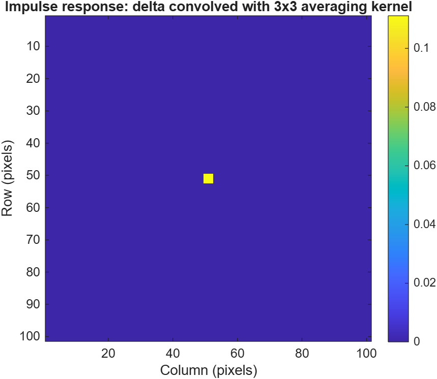
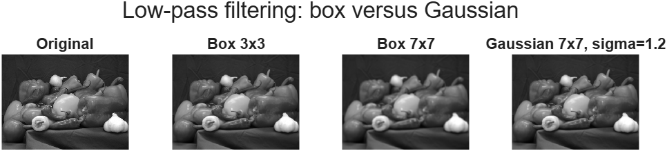
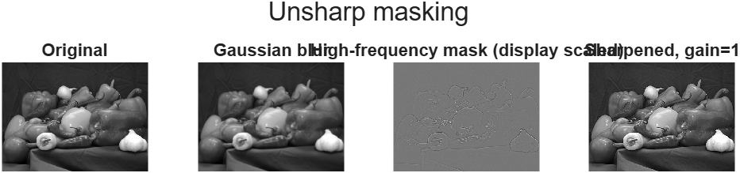
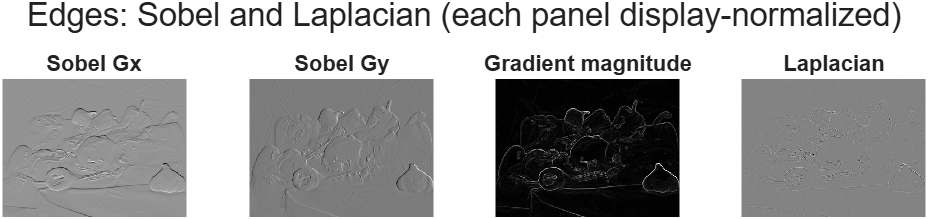
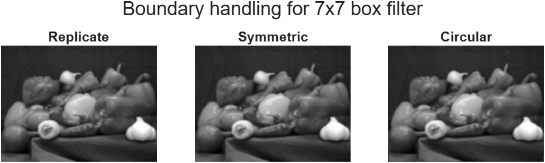

# Lab 2 — 2D Convolution & FIR Filters (Blur, Sharpen, Edges)

**Course:** Mathematical Algorithms (DSP) — Image Processing Labs  
**Submission:** GitHub repository URL only  
**Due:** 29 November 2026, 23:00 (as stated in Moodle)

## Objective

Investigate images as two-dimensional signals, and study how finite impulse response (FIR) kernels implement spatial convolution for smoothing, sharpening and edge detection. Compare Gaussian and box filtering, convolution and correlation, and boundary-handling choices.

## Files

```text
Lab2-2D-Convolution-FIR-Filters/
├── Lab2_convolution_FIR.m
├── README.md
├── lab2_measurements.txt           # Generated when script runs
├── 01_impulse_response.png        # Generated when script runs
├── 02_blur_comparison.png         # Generated when script runs
├── 03_unsharp_masking.png         # Generated when script runs
├── 04_edge_detection.png          # Generated when script runs
└── 05_boundary_handling.png       # Generated when script runs
```

## How to run

1. Open MATLAB Online and upload `Lab2_convolution_FIR.m`.
2. Confirm Image Processing Toolbox is available and that `peppers.png` or `cameraman.tif` can be found.
3. Run `Lab2_convolution_FIR.m` and review the five saved PNG figures.
4. Open `lab2_measurements.txt`. Copy the observed numerical results below.
5. Download the five PNGs and measurements from MATLAB Drive, then add them to this GitHub folder.

## 1. Delta image and impulse response



The input delta image contains a single nonzero pixel. Convolving it with the normalized 3×3 averaging kernel produces the shifted kernel itself: nine values of `1/9` in a 3×3 neighborhood. This illustrates the impulse-response interpretation of a 2D FIR filter.

**My observation after running MATLAB:** [Describe where the nonzero pixels appear and the colorbar values.]

## 2. Low-pass filtering: box vs Gaussian



The 3×3 box filter averages nine neighboring pixels; the 7×7 box filter averages 49. A larger box generally gives more smoothing but can obscure fine details. The Gaussian uses smooth spatial weights rather than uniform box weights, usually giving a smoother frequency response than a large box filter.

**Separable Gaussian:** The 7×7 kernel is built as the outer product `g1d' * g1d`. Filtering with two one-dimensional passes (one horizontal, one vertical) can reduce per-pixel multiplication count from 49 to about 14, ignoring implementation details and boundary handling.

**My observation:** [Compare the extent of smoothing and any detail loss in each image.]

## 3. Unsharp masking



The high-frequency mask is computed as `mask = I - I_blur`, and the sharpened image is `clip(I + gain * mask, 0, 1)` with gain 1. It boosts local detail and edges but can also amplify noise or cause bright/dark halos. The displayed mask is contrast-scaled for visibility, not a direct measurement of its numeric amplitude.

**My observation:** [Describe which edges appear sharper and whether you see any artifacts.]

## 4. Sobel and Laplacian edge filtering



Sobel filtering estimates image changes in two perpendicular directions. The gradient magnitude `hypot(Gx,Gy)` combines those responses. The Laplacian is a second-derivative filter that responds to changes in intensity regardless of direction; it can also react strongly to noise. The panels are individually normalized for display, so their visual brightnesses are not directly comparable as absolute filter magnitudes.

**My observation:** [Identify the strongest edges and compare Sobel magnitude with Laplacian.]

## 5. Correlation vs convolution

`conv2(I,h_box3,'same')` and `imfilter(I,h_box3,'conv','same',0)` apply the same 3×3 averaging kernel with zero padding. Their maximum absolute difference should be near floating-point precision. Convolution flips the kernel spatially before applying it, whereas correlation does not. Because the box kernel is symmetric, the two operations give the same result for this kernel. The script additionally compares an **asymmetric** kernel to demonstrate that correlation and convolution can produce different results.

**My actual MATLAB results (`lab2_measurements.txt`):**

- `conv2` vs `imfilter` max difference: **[insert measurement]**
- Asymmetric-kernel correlation vs convolution max difference: **[insert measurement]**
- Gaussian 2D vs two 1D passes max difference: **[insert measurement]**

## 6. Boundary handling



For pixels near image borders, the kernel needs values outside the image. `replicate` extends border pixel values, `symmetric` reflects the image across its boundary, and `circular` wraps to pixels on the opposite side. Differences are usually most evident near borders and corners; all three methods use the same 7×7 box kernel.

**My observation:** [Describe any visible changes near the corners or outer edge.]

## 7. Reflections

**Why prefer a Gaussian over a large box low-pass filter?** The Gaussian's smoothly varying weights tend to produce a smoother frequency response with fewer pronounced sidelobes than a rectangular box kernel, helping reduce unwanted ringing or passband/stopband ripples. The best kernel depends on the task.

**What does separability do for computational cost?** A separable 7×7 Gaussian can be implemented as two 1D filters of length 7. This generally needs fewer multiply-accumulate operations per image pixel than a direct 49-coefficient convolution.

**How do boundary modes change corners and edges?** They supply different virtual pixels outside the image. As a result, the filtered border pixels can differ, even though the interior result is the same when the filter neighborhood fits fully within the image.

## MATLAB verification

- Image source: **[copy from lab2_measurements.txt]**
- Image dimensions: **[copy from lab2_measurements.txt]**
- All five PNG figures reviewed: **[yes, after checking]**
- MATLAB version: **[record your MATLAB version]**
- Image Processing Toolbox: **[confirm availability]**
