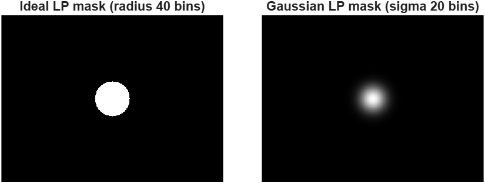
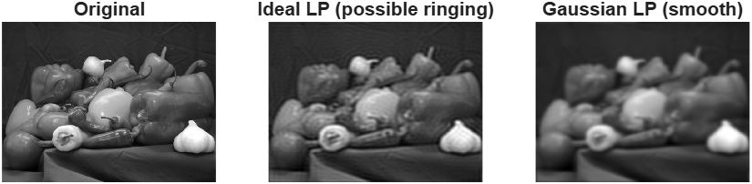
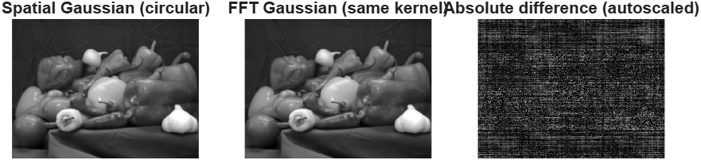

# Lab 3 – Frequency-Domain Filtering with `fft2`

**Course:** Mathematical Algorithms (DSP) — Image Processing Labs  
**Submission:** GitHub URL only  
**Deadline:** 29 November 2026, 23:00 (as stated in the assignment)

## Objective

Investigate image filtering in the 2D frequency domain using `fft2`, `fftshift`, frequency masks, and `ifft2`. Compare ideal and Gaussian low-pass filtering, show Gaussian high-pass filtering, and verify the convolution theorem with matched spatial and FFT filters.

## Files

```text
Lab3-Frequency-Domain-Filtering/
├── Lab3_fft2_filtering.m
├── README.md
├── 01_log_magnitude_spectrum.png        # generated in MATLAB
├── 02_lowpass_masks.png                 # generated in MATLAB
├── 03_lowpass_comparison.png            # generated in MATLAB
├── 04_highpass_comparison.png           # generated in MATLAB
├── 05_spatial_vs_frequency.png          # generated in MATLAB
└── lab3_measurements.txt                # generated in MATLAB
```

## How to run

1. Upload `Lab3_fft2_filtering.m` to MATLAB Online or open it in MATLAB Desktop.
2. Use a MATLAB installation with Image Processing Toolbox (`imshow`, `imfilter`, `fspecial`, `psf2otf`).
3. Run the entire script. It uses MATLAB's `peppers.png` if available; otherwise `cameraman.tif`.
4. Check each saved PNG figure and read `lab3_measurements.txt`.
5. Add the generated files to this project folder before pushing to GitHub.

## 1. Log-magnitude spectrum

`fft2` computes the 2D DFT. `fftshift` moves the zero-frequency (DC) component from the array corner to the center of the displayed spectrum. `log(1 + abs(...))` makes weak frequency components more visible.


**My observation after running MATLAB:** [Describe where the strongest parts of the spectrum appear and what details you see.]

## 2. Low-pass masks and results

The ideal low-pass mask keeps frequencies within a cutoff radius of **40 frequency bins** and rejects the rest abruptly. The Gaussian frequency-domain mask uses **sigma = 20 frequency bins** and changes smoothly with frequency.





**My observation after running MATLAB:** [Compare sharpness, blur, and any bright/dark ringing near strong edges.]

### Why can ideal low-pass filtering cause ringing?

A sharp circular cutoff in the frequency domain corresponds to an oscillatory, spatially extended impulse response. At image boundaries and strong intensity transitions, that response can cause overshoot and undershoot (ringing/Gibbs-like artifacts). A Gaussian filter has a smooth frequency transition, so ringing is generally less pronounced.

## 3. Gaussian high-pass filter

The complementary filter `H_HP = 1 - H_LP` emphasizes higher spatial frequencies such as edges and fine texture. Its raw result may include negative intensities; `mat2gray` is used **only to display** the signed result on a visible grayscale range.


**My observation after running MATLAB:** [Describe the edges or fine details that became prominent.]

## 4. Spatial versus frequency-domain Gaussian filtering

The starter example uses two **different** Gaussian filters: a 7×7 spatial Gaussian with sigma **1.2 pixels**, and a frequency-domain Gaussian with sigma **20 frequency bins**. Their images are not expected to match closely merely because both filters are Gaussian. The default `replicate` spatial boundary also differs from the periodic boundary implicit in the DFT.

For a fair convolution-theorem test, the script applies the **same 7×7 Gaussian kernel** using:

- `imfilter(..., 'circular', 'conv')` in the spatial domain;
- `fft2(I) .* psf2otf(kernel, size(I))`, followed by `ifft2`, in the frequency domain.

They should agree to floating-point precision. Check the actual measured maximum difference and RMSE in `lab3_measurements.txt`.



**Measured max absolute difference:** [Copy from `lab3_measurements.txt`]  
**Measured RMSE:** [Copy from `lab3_measurements.txt`]  
**My observation after running MATLAB:** [Compare the first two images and the difference image.]

## 5. Reflection questions

**1. Why does ideal LP cause ringing?**  
The abrupt cutoff in frequency produces a spatial response with oscillatory sidelobes. These cause overshoot/undershoot around strong image transitions. Smooth Gaussian attenuation reduces this effect.

**2. What does `fftshift` do visually?**  
It rearranges the Fourier spectrum so that the zero-frequency component appears in the center, with low frequencies near the center and higher frequencies farther away. It does not create new frequency information.

**3. When is frequency-domain filtering computationally preferable?**  
It is often useful for large convolution kernels, repeated filtering with precomputed filter transforms, and filters naturally specified in frequency coordinates. For small kernels (for example 3×3 or 7×7), direct or separable spatial filtering is often simpler and faster because FFTs have setup costs. Boundary handling must be considered in any speed or accuracy comparison.

## 6. Lab environment and verification

- **MATLAB version:** [Copy from your MATLAB installation]
- **Image Processing Toolbox:** [Confirm available]
- **Source image:** [Copy from `lab3_measurements.txt`]
- **Saved figures checked:** [List the figures you opened]
- **Numerical verification:** [Copy the matched-kernel max difference and RMSE]
