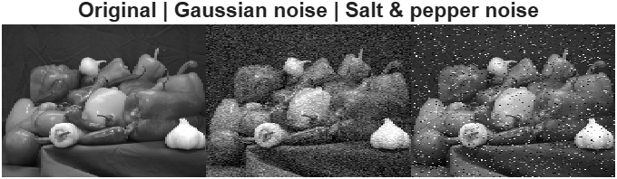
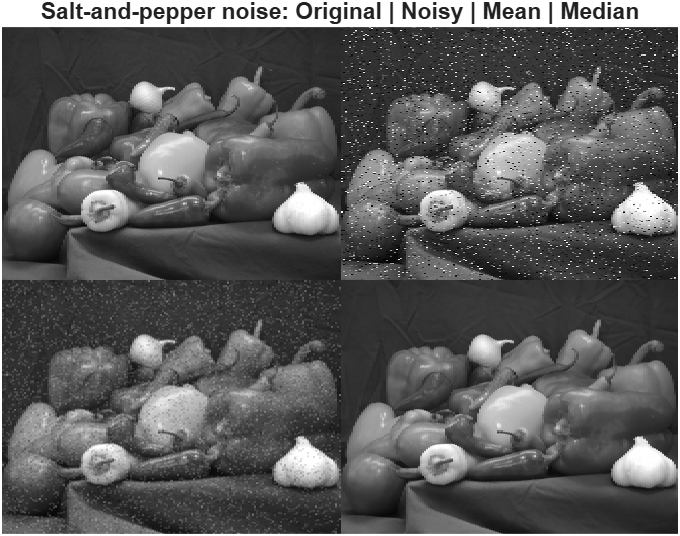
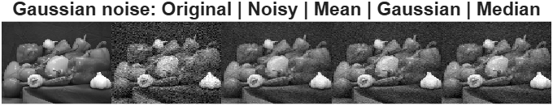
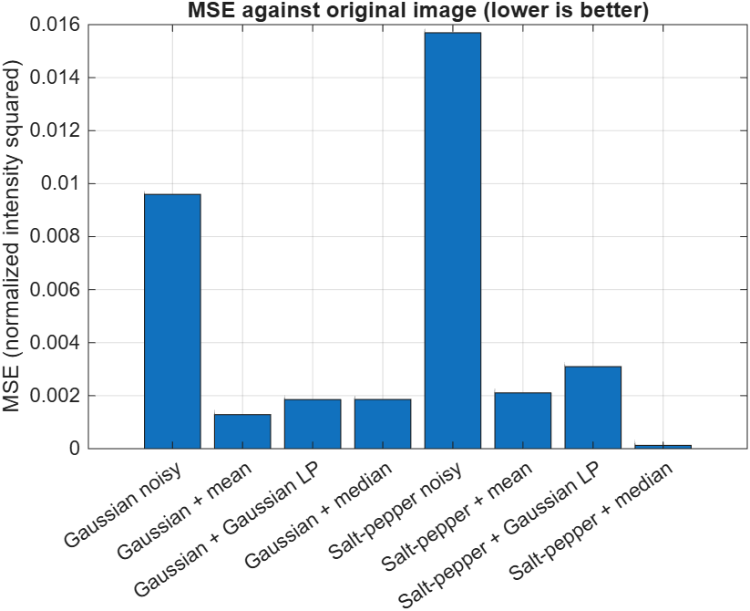

# Lab 4 — Noise and Filtering

**Course:** Mathematical Algorithms (DSP) — Image Processing Labs  
**Submission:** GitHub repository URL only  
**Deadline listed in Moodle:** 29 November 2026, 12:00 AM

## Objective

Investigate Gaussian noise and salt-and-pepper noise in a grayscale image. Compare a 3×3 mean filter, a 3×3 Gaussian filter (σ = 0.7), and a 3×3 median filter using visual results and reference-based MSE and SNR.

## Project files

```text
Lab4-Noise-and-Filtering/
├── Lab4_noise_filtering.m
├── README.md
├── 01_noise_types.png                # generated in MATLAB
├── 02_salt_pepper_filtering.png      # generated in MATLAB
├── 03_gaussian_filtering.png         # generated in MATLAB
├── 04_mse_comparison.png            # generated in MATLAB
├── lab4_measurements.txt            # generated in MATLAB
└── lab4_results.csv                 # generated in MATLAB
```

## Requirements and execution

MATLAB with **Image Processing Toolbox** (for `imnoise`, `imfilter`, `medfilt2`, `fspecial`, and image viewing). The script uses `peppers.png`, with `cameraman.tif` as a fallback. It sets `rng(7)` to make the random noise repeatable.

1. Open `Lab4_noise_filtering.m` in MATLAB Online.
2. Click **Run** to generate the figures and measurements in the script folder.
3. Inspect every saved PNG, especially the difference between salt-and-pepper filtering methods.
4. Read `lab4_measurements.txt` and replace the result placeholders below with your actual MATLAB values.
5. Download all generated outputs and add them to GitHub along with the script and this README.

## 1. Noise generation



- **Gaussian noise** adds random changes to pixel intensities across the image (variance 0.01 in the starter experiment).
- **Salt-and-pepper noise** replaces a fraction of pixel values with black or white extremes (density 0.05).

**Observation after running:** [Describe what you saw in your original and two noisy images.]

## 2. Filtering salt-and-pepper noise



A **mean filter** averages neighboring pixels, so extreme outliers can affect the result and edges become smoother. A **median filter** selects the neighborhood's middle-ranked value, making it particularly useful for removing sparse black/white impulses while often preserving edges better.

**Observation after running:** [Which output looked cleaner, and what happened to object boundaries?]

## 3. Filtering Gaussian noise



The mean and Gaussian filters reduce rapid intensity variations by spatial averaging. The Gaussian filter weights nearby pixels according to a Gaussian kernel. The median filter is nonlinear and may behave differently for Gaussian noise than it does for impulse noise.

**Observation after running:** [Compare mean, Gaussian and median filters. Mention loss of fine detail if visible.]

## 4. Quantitative evaluation: MSE and SNR

Mean-square error against the known clean image:

\[
\operatorname{MSE}=\frac{1}{MN}\sum_{m=1}^{M}\sum_{n=1}^{N}(I_{\mathrm{result}}(m,n)-I_{\mathrm{clean}}(m,n))^2
\]

Reference-based signal-to-noise ratio:

\[
\operatorname{SNR}_{\mathrm{dB}}=10\log_{10}\frac{\sum I_{\mathrm{clean}}(m,n)^2}{\sum (I_{\mathrm{result}}(m,n)-I_{\mathrm{clean}}(m,n))^2}
\]

Lower MSE and higher reference-based SNR indicate closer agreement with the clean image. They do not capture all aspects of visual quality, such as whether some edges look overly smooth.



**Fill in from MATLAB output (do not invent numbers):**

| Signal | MSE | SNR (dB) |
|---|---:|---:|
| Gaussian noisy | [measured] | [measured] |
| Gaussian + mean | [measured] | [measured] |
| Gaussian + Gaussian LP | [measured] | [measured] |
| Gaussian + median | [measured] | [measured] |
| Salt-pepper noisy | [measured] | [measured] |
| Salt-pepper + mean | [measured] | [measured] |
| Salt-pepper + Gaussian LP | [measured] | [measured] |
| Salt-pepper + median | [measured] | [measured] |

**Interpretation of your measured results:** [State which filter achieved the lowest MSE for each noise type, and whether the figures agree.]

## 5. Reflection answers

**Which noise is best removed by a median filter, and why?**  
The median filter is especially suitable for salt-and-pepper noise because isolated extreme-valued pixels are unlikely to determine the median of a neighborhood. It can remove many such impulses without averaging them into nearby pixels.

**Why does linear filtering blur edges more?**  
Mean and Gaussian smoothing combine nearby values on both sides of a boundary. This reduces noise but also reduces the contrast of sharp transitions, which appear softer after filtering.

**How might adaptive filtering preserve details?**  
One improvement would be to use local variance or edge strength to reduce smoothing in detailed areas while allowing stronger filtering in flatter regions. Adaptive median filter sizes can also help when impulse-noise density varies.
