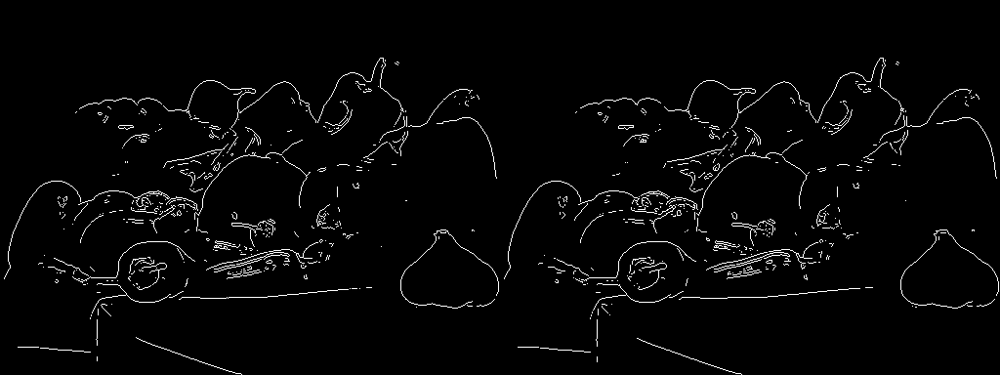
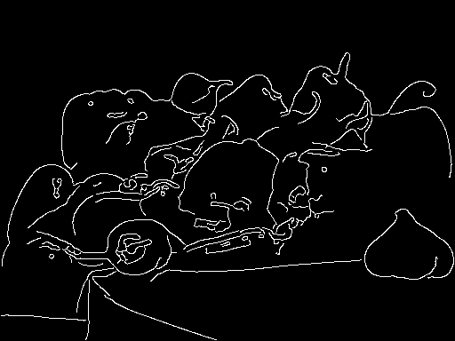
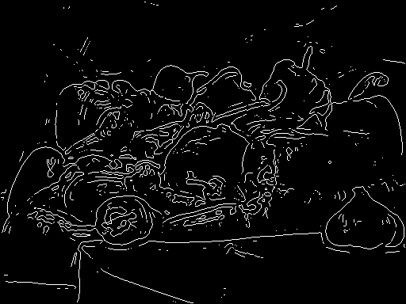
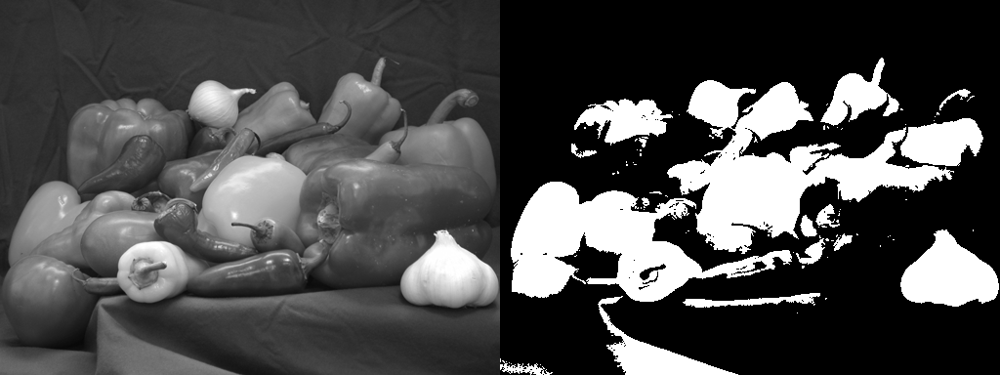
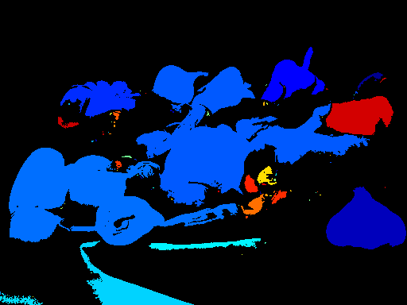
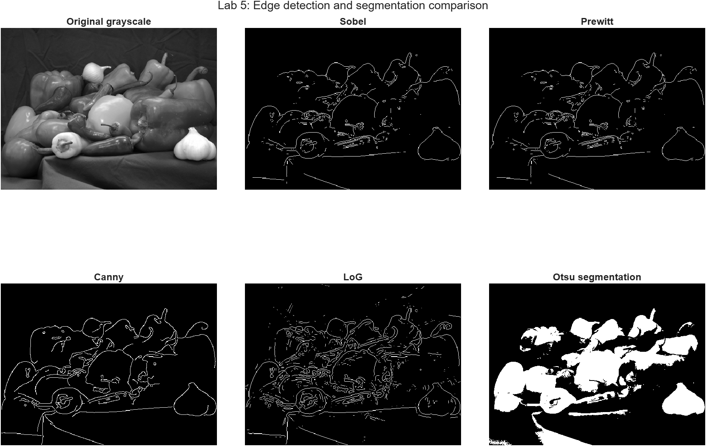

# Lab 5 — Edge Detection and Segmentation

**Course:** Mathematical Algorithms (DSP) — Image Processing Labs  
**Submission:** GitHub repository URL only  
**Due:** 29 November 2026, 12:00 AM (as shown in Moodle)

## Objective

Investigate image edges as high-frequency image features; compare Sobel, Prewitt, Canny, and Laplacian of Gaussian (LoG) edge detectors; use Otsu's method to binarize a grayscale image; and label connected regions in the resulting binary mask.

## Requirements and instructions

- MATLAB with Image Processing Toolbox (functions include `edge`, `graythresh`, `imbinarize`, `bwlabel`, `label2rgb`).
- An accessible MATLAB sample image (`peppers.png`, or the `cameraman.tif` fallback).
- Run `Lab5_edge_segmentation.m` from MATLAB Online or desktop MATLAB. The script automatically saves the figures and measurement files alongside the script.
- Open every exported PNG and verify the figures are readable before committing to GitHub.

## Project files

```text
Lab5-Edge-Detection-Segmentation/
├── Lab5_edge_segmentation.m
├── README.md
├── 01_sobel_prewitt.png                 # created by running MATLAB
├── 02_canny_edges.png                  # created by running MATLAB
├── 03_log_edges.png                    # created by running MATLAB
├── 04_otsu_segmentation.png            # created by running MATLAB
├── 05_labeled_regions.png              # created by running MATLAB
├── 06_method_comparison.png            # created by running MATLAB
├── lab5_measurements.txt               # created by running MATLAB
└── edge_pixel_counts.csv               # created by running MATLAB
```

## Section 1 — Sobel and Prewitt



Both detectors use first-order intensity gradients to identify brightness changes. Sobel gives additional weight to the center row/column of its derivative mask, while Prewitt uses equal weights. Their edges may differ in sensitivity and continuity.

**My observation after running MATLAB:** [Compare how the two maps show the actual edges in your image, including any weak or broken edges.]

## Section 2 — Canny



Canny uses smoothing, gradient calculations, non-maximum suppression, and threshold-based edge tracking to produce relatively thin, connected edges. The script uses thresholds `[0.05 0.2]`.

**My observation:** [Describe whether Canny looks thinner/cleaner than Sobel and Prewitt for your generated plot; mention any missed or extra edges.]

## Section 3 — Laplacian of Gaussian (LoG)



The LoG method smooths the image and detects zero crossings associated with second-derivative changes. It can respond differently to texture and noise than gradient-based detectors.

**My observation:** [Describe how the LoG map differs from the other three.]

## Section 4 — Otsu thresholding and segmentation



Otsu's method examines the image histogram and chooses a global grayscale threshold that maximizes between-class variance (equivalently, minimizes within-class variance for two classes). `imbinarize` uses the resulting threshold to produce a binary mask.

**Measured Otsu threshold:** [Copy from `lab5_measurements.txt`]  
**Foreground percentage:** [Copy from `lab5_measurements.txt`]  
**My observation:** [Explain which light/dark image areas become foreground and whether one global threshold separates objects well.]

## Section 5 — Connected region labeling



`bwlabel(BW,8)` groups neighboring foreground pixels into 8-connected components. `label2rgb` assigns display colors to those labels. A connected component is not necessarily a separate real-world object; illumination and the threshold can split or merge regions.

**Measured number of connected components:** [Copy from `lab5_measurements.txt`]  
**My observation:** [Describe any merged or fragmented regions.]

## Section 6 — Comparison



| Method | Principle | Possible trade-off |
|---|---|---|
| Sobel | Weighted first derivative | Simple; may yield thicker or broken edges |
| Prewitt | Uniform first derivative | Simple; potentially sensitive to noise |
| Canny | Smoothed gradient, non-maximum suppression, hysteresis | Often thin, continuous edges; depends on thresholds |
| LoG | Second-derivative zero crossings after smoothing | Sensitive to scale and parameter settings |
| Otsu | Global histogram threshold | Fast; can fail under uneven lighting or overlapping intensity distributions |

**Measured edge-pixel counts:** [Use `edge_pixel_counts.csv`; counts are not by themselves an edge-quality score.]

## Reflections

**1. Which operator gives the thinnest, cleanest edges?**  
Canny is designed to produce thin edges by non-maximum suppression and usually gives a well-defined map. **Verification from my plots:** [Confirm or adjust based on what you see.]

**2. Why can Canny outperform simple gradient filters?**  
It smooths noise, reduces thick gradient responses to local maxima, and uses double thresholds with edge tracking. These steps may reduce spurious edges and improve continuity, although the outcome depends on the image and chosen thresholds.

**3. How does Otsu relate to histogram-based thresholding?**  
Otsu determines a global threshold from the image intensity histogram by maximizing the separation between two intensity classes. It works best when their distributions are sufficiently distinct; it is not a full object-recognition method.

