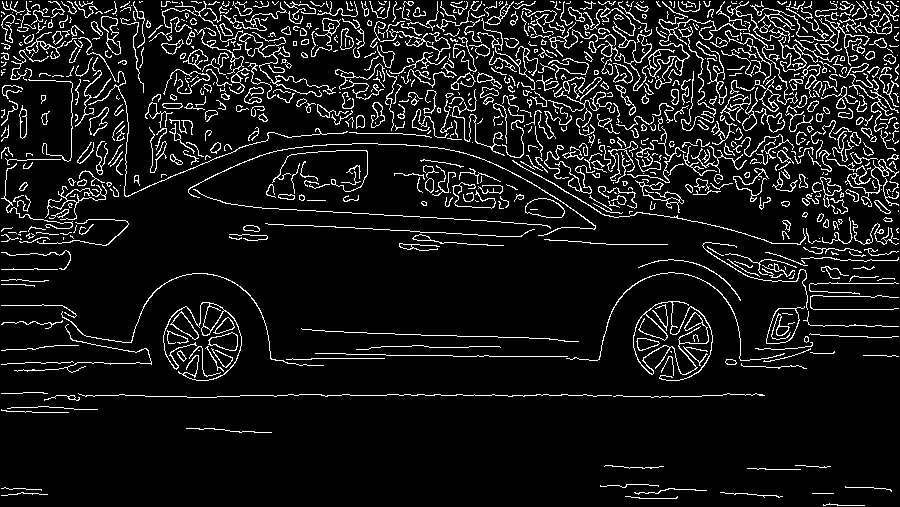
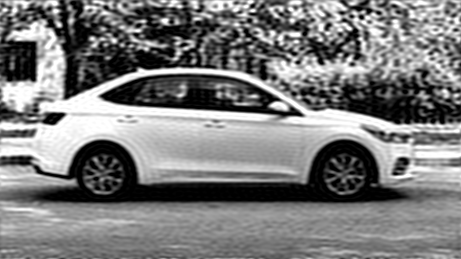
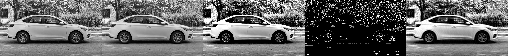

# Lab 6 — Mini Project: Integrated Image Processing

**Course:** Mathematical Algorithms (DSP) — Image Processing Labs  
**Submission:** GitHub repository URL (due 29 November 2026, 00:00, as stated in Moodle)

## 1. Project goal and selected problem

This experiment combines image denoising, intensity enhancement, edge detection, and frequency-domain filtering into a short processing pipeline. I use a self-selected image to investigate whether noise can be reduced and visual structures made more recognizable while retaining useful detail.

**My selected image:** `[enter image filename and what it shows]`  
**Problem to address:** `[describe the real problem in your image, such as noise or weak contrast; do not claim a problem you did not observe]`

## 2. Folder contents

```bash
Lab6-Integrated-Image-Processing/
├── Lab6_image_pipeline.m
├── README.md
├── car.jpg                 # AI-generated example input
├── building.jpg            # AI-generated example input
├── flower.jpg              # AI-generated example input
├── landscape.jpg           # AI-generated example input
├── 01_original.png
├── 02_denoised.png
├── 03_contrast_enhanced.png
├── 04_canny_edges.png
├── 05_frequency_lowpass.png
├── 06_frequency_mask.png
├── 07_pipeline_comparison.png
└── lab6_measurements.txt
```

**Example input images provided:** `car.jpg`, `building.jpg`, `flower.jpg`, and `landscape.jpg` are AI-generated example photographs for testing. They are not personal photographs. If the instructor requires an image you personally selected or photographed, use an appropriate own image instead and accurately identify its source in this README.

**Source image:** Add your selected image to this folder too (if allowed), or explain its origin. Do not add a copyrighted image without permission to redistribute it.

## 3. MATLAB setup and how to run

1. Upload `Lab6_image_pipeline.m` and an image you are permitted to use to MATLAB Drive.
2. Open the script in MATLAB Online, then select **Run**.
3. When the file-selection dialog appears, select your image.
4. Check the labeled comparison and frequency-mask figures, and verify the seven PNG files open correctly.
5. Open `lab6_measurements.txt`, then fill in the measured values and observations below.

**Required:** MATLAB with Image Processing Toolbox.  
**MATLAB version used:** `[fill in after running]`

## 4. Processing stages and DSP meaning

### Stage 1 — Grayscale image as a 2D signal
The image is converted to double-precision grayscale intensity values within the range 0–1. Each pixel is a sample of a two-dimensional signal.


### Stage 2 — Noise removal with a 3×3 median filter
The median filter replaces each pixel using the median of its local neighborhood. Unlike a linear mean filter, it is a nonlinear spatial operation. It can suppress isolated impulsive pixels while often retaining edge transitions better than simple averaging.


**What I observed:** `[describe whether noise was removed or fine texture was lost]`

### Stage 3 — Contrast enhancement
`imadjust` remaps the intensity interval [0.2, 0.8] to [0, 1], clipping values outside the selected input range. This enhances contrast over the chosen range but can lose dark or bright details.


**What I observed:** `[describe which details became clearer and whether anything was clipped]`

### Stage 4 — Canny edges
Canny detects intensity changes using gradient information, nonmaximum suppression, and hysteresis thresholding. The script uses thresholds [0.1, 0.25] on the enhanced image.



**What I observed:** `[describe the object boundaries and any missing or unwanted edges]`

### Stage 5 — Frequency-domain low-pass filtering
The script calculates the 2D FFT, centers the spectrum with `fftshift`, multiplies it by a circular *ideal* low-pass mask of radius 60 frequency bins, then reconstructs using the inverse FFT. High spatial frequencies are suppressed, reducing fine detail and potentially causing ringing near sharp edges because of the abrupt cutoff. FFT filtering here implicitly uses periodic (circular) boundary handling.




**What I observed:** `[describe smoothing and possible ringing/edge artifacts]`

## 5. Overall comparison

The five panels are, left to right: original grayscale, median-filtered, contrast-enhanced, Canny edges, and frequency-domain low-pass.



**Measurements copied from `lab6_measurements.txt`:**

| Item | Measured value |
|---|---|
| Input image and dimensions | `[fill in]` |
| Mean intensity before enhancement | `[fill in]` |
| Mean intensity after enhancement | `[fill in]` |
| Canny edge pixels and proportion | `[fill in]` |
| RMSE of enhanced image vs FFT-LP output | `[fill in]` |

The RMSE above measures how much the low-pass image differs from the enhanced image; a smaller RMSE alone does **not** prove that image quality improved.

## 6. Short reflections

**How each stage relates to DSP:** The median filter processes local spatial neighborhoods; contrast adjustment changes signal amplitude nonlinearly; edge detection highlights rapid spatial variations; and FFT masking modifies spatial-frequency components before reconstruction.

**Improvements and limitations:** This workflow uses fixed parameters that might not suit every image. Median filtering may remove small useful details; contrast remapping can clip intensities; Canny thresholds may miss low-contrast boundaries or detect texture; and the ideal low-pass filter may introduce ringing and circular boundary artifacts. A practical improvement would be to compare settings systematically and, where suitable, replace the ideal frequency cutoff with a smooth Gaussian low-pass response.


