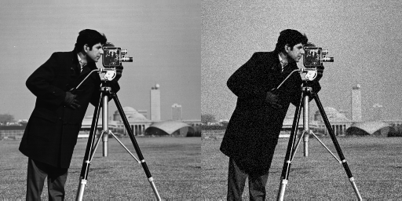
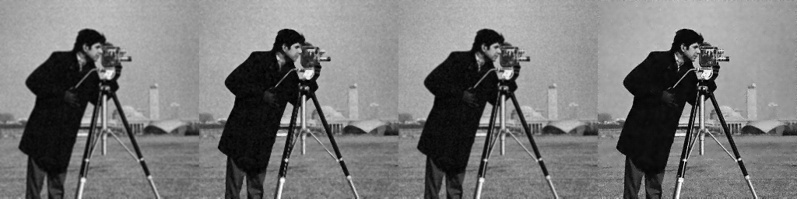

# Lab 7 — Traditional vs AI Gaussian Filters

## Objective

Investigate the effect of additive Gaussian noise on a grayscale image and compare traditional denoising filters with the pretrained DnCNN model. Evaluate performance against the known original using mean-square error (MSE), peak signal-to-noise ratio (PSNR), and structural similarity (SSIM).

## Setup and reproducibility

- Input: `cameraman.tif` (MATLAB sample image)
- Noise: zero-mean Gaussian, standard deviation **0.04**, variance **0.0016**
- Random seed: `rng(7)` for reproducibility
- MATLAB version: **[copy from `lab7_measurements.txt`]**
- Image Processing Toolbox: required
- Deep Learning Toolbox and pretrained **DnCNN**: required for the AI comparison. If unavailable, this is reported explicitly rather than substituting a different filter.

### Run

```bash
# In MATLAB Online: open Lab7_traditional_vs_AI.m and click Run.
# Then inspect the figures and read lab7_metrics.csv / lab7_measurements.txt.
```

## Methods

| Method | Parameters | Type |
|---|---|---|
| Mean | 3×3 kernel | Linear averaging |
| Median | 3×3 neighborhood | Nonlinear rank filter |
| Gaussian | Standard deviation 0.7 | Linear Gaussian smoothing |
| Wiener | 5×5, supplied variance 0.0016 | Adaptive, traditional |
| DnCNN | Pretrained model | AI / learned denoiser |

All methods operate on **the same noise realization** and are compared against the same original reference image. The Wiener method is the primary traditional baseline in the instructor's sample code; mean, median and Gaussian filters are added to cover the stated learning outcomes.

## Figures

### Original image vs Gaussian noise



*Left: original; right: Gaussian-noisy image.*

### Traditional filtering



*Left to right: mean 3×3, median 3×3, Gaussian σ=0.7, Wiener 5×5.*

### Wiener vs DnCNN (only if AI model ran successfully)

If `03_wiener_vs_DnCNN.png` is generated, include it here after checking it:

``

*Left to right: original, noisy, Wiener, DnCNN.*

If the model was unavailable, record the error instead of claiming AI results.

## Results

Copy actual values from `lab7_metrics.csv` into this table after running the script:

| Method | MSE (lower better) | PSNR dB (higher better) | SSIM (higher better) |
|---|---:|---:|---:|
| Noisy | [measured] | [measured] | [measured] |
| Mean | [measured] | [measured] | [measured] |
| Median | [measured] | [measured] | [measured] |
| Gaussian | [measured] | [measured] | [measured] |
| Wiener | [measured] | [measured] | [measured] |
| DnCNN | [measured if available; otherwise N/A] | [measured or N/A] | [measured or N/A] |

**Interpretation:** MSE measures squared numerical error; PSNR summarizes error on a logarithmic decibel scale; SSIM compares local structural similarity. These are reference-based metrics, so the known clean `cameraman.tif` is necessary. Neither high PSNR nor high SSIM guarantees that every fine detail is visually preserved.

**Observation to write yourself:** Which filter performed best on your measured MSE, PSNR and SSIM? Was its visual appearance also preferable? Compare textures and edges, not just scores. Do **not** assume DnCNN outperformed Wiener unless the MATLAB results demonstrate it.

## Short reflections

**1. Why compare different traditional filters?** Mean and Gaussian filters smooth nearby pixels and may blur edges. Median filtering is useful for impulsive noise, but is not guaranteed to be best for Gaussian noise. Wiener filtering adapts to local statistics and can preserve details better than uniform averaging in some images.

**2. Why is DnCNN considered an AI approach?** It uses a pretrained convolutional neural network that learned patterns from training data, rather than a fixed, manually chosen averaging kernel. Its effectiveness must be checked on the image and noise level actually used.

**3. Limitations and improvements.** The experiment uses one grayscale example, one random noise realization and one noise level. Repeat over several images and noise seeds, compare execution times, and inspect edge/detail preservation to support broader conclusions.

## AI assistance declaration

ChatGPT assisted with the MATLAB project structure and documentation. I ran and verified the MATLAB script and measured values myself. **[Update this paragraph to reflect what you actually did.]**

## Submission checklist

- [ ] Script runs and MATLAB version is recorded
- [ ] `01_original_and_noisy.png` and `02_traditional_filters.png` verified
- [ ] `03_wiener_vs_DnCNN.png` verified, OR DnCNN unavailability documented
- [ ] `lab7_metrics.csv` and `lab7_measurements.txt` included
- [ ] Actual measurements inserted into Results
- [ ] My own visual observations and AI declaration completed
- [ ] GitHub repository or Lab7 folder uploaded and checked
- [ ] GitHub URL submitted in Moodle

## References

- [MathWorks: Denoising images with neural networks](https://www.mathworks.com/help/images/ref/denoiseimage.html)
- [MathWorks: Adaptive Wiener filtering (`wiener2`)](https://www.mathworks.com/help/images/ref/wiener2.html)
- [MathWorks: PSNR](https://www.mathworks.com/help/images/ref/psnr.html)
- [MathWorks: Image Processing deep learning requirements](https://www.mathworks.com/help/images/deep-learning.html)
