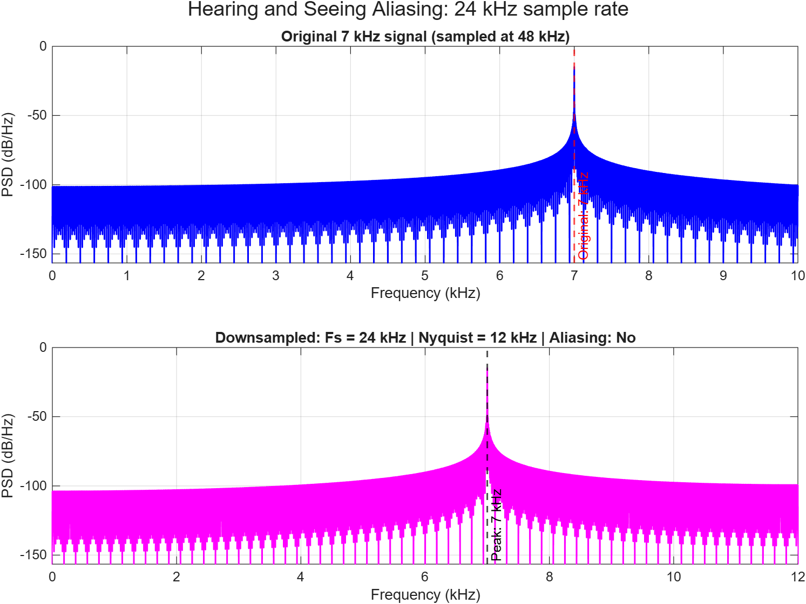
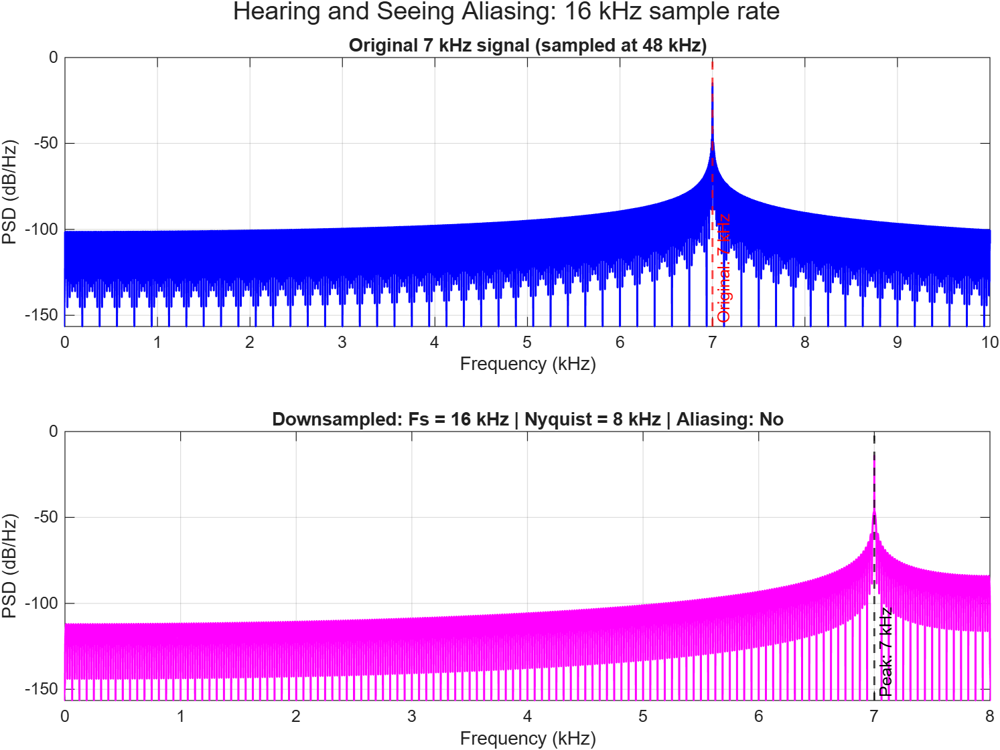
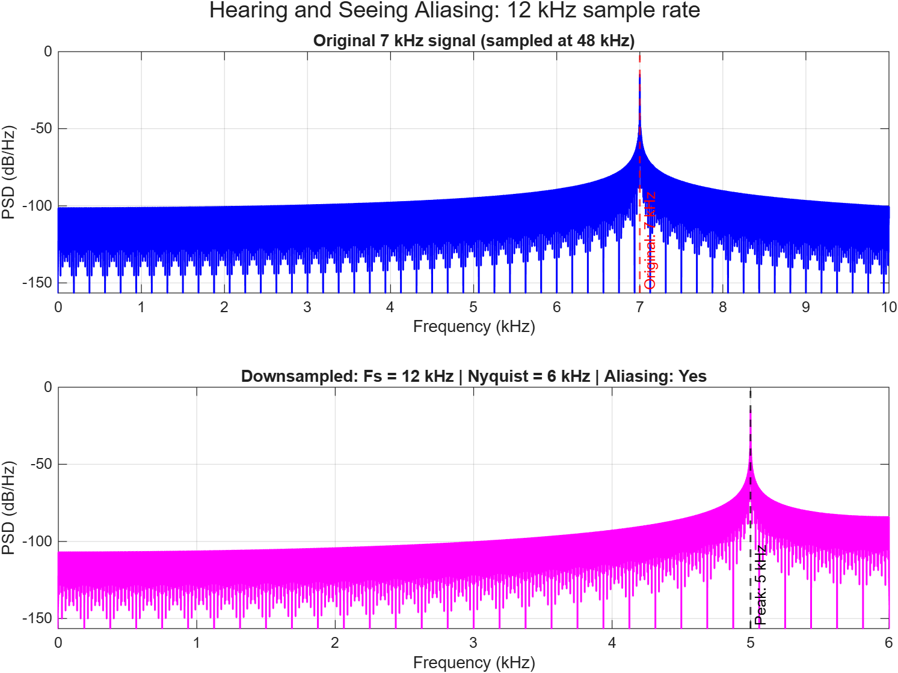
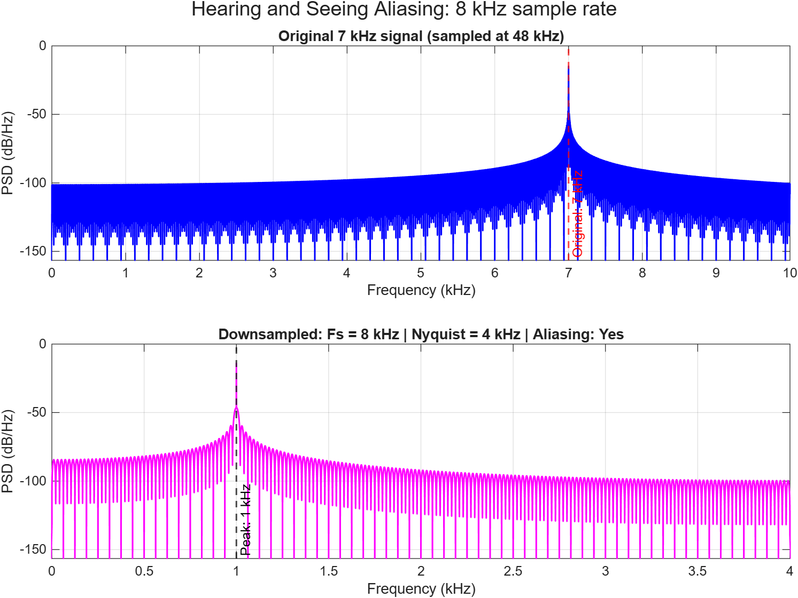

# Lecture 02 – In-Class Assignment: Hearing and Seeing Aliasing

## Purpose

Explore how changing the sample rate affects the representation and playback of an original **7 kHz** sine tone. Downsampling **without an anti-aliasing filter** intentionally illustrates frequency folding.

## Experiment setup

| Parameter | Value |
| --- | --- |
| Original signal frequency | 7,000 Hz (7 kHz) |
| Original sample rate | 48,000 Hz |
| Duration | 2 seconds |
| Tone amplitude | 0.20 |
| Tested sample rates | 24, 16, 12, and 8 kHz |
| Analysis method | MATLAB `periodogram` (PSD versus frequency) |

**Safety:** Listen at low device volume; 7 kHz can be uncomfortable. The MATLAB script starts with `playAudio = false`. After setting a safe device volume, change this to `true` if you want to compare the sounds. The script uses `sound` rather than `soundsc` to preserve the same signal amplitude scale for each playback.

## How to run

1. Open `Lecture02_hearing_seeing_aliasing.m` in MATLAB.
2. Click **Run**. It analyzes all four sample rates and saves the plots automatically.
3. Inspect `sampling_results.csv` and the four spectrum images.
4. To complete the listening part, set `playAudio = true`, lower your device volume, and rerun. Describe what you actually hear.

**Note:** The code corrects a unit mismatch in the assignment starter plot: `periodogram` supplies frequency values in **Hz**, while the requested axes are in **kHz**. The script plots `f/1000` with matching limits and labels.

## Results table

These are the **theoretical expected frequencies**, not a claim of observed MATLAB results. Confirm against `sampling_results.csv` after running the script.

| Sampling frequency | Nyquist frequency | Expected spectral peak | Expected aliasing |
| --- | --- | --- | --- |
| 24 kHz | 12 kHz | 7 kHz | No |
| 16 kHz | 8 kHz | 7 kHz | No |
| 12 kHz | 6 kHz | 5 kHz | Yes |
| 8 kHz | 4 kHz | 1 kHz | Yes |

### Figures









> These images will display on GitHub after you run the script and upload the generated PNG files.

## Nyquist check

The original tone is 7 kHz. To avoid aliasing for this tone, the sampling rate must exceed twice its frequency in this experiment:

\[
f_s > 2(7\,\mathrm{kHz}) = 14\,\mathrm{kHz}.
\]

The tested **24 kHz and 16 kHz** rates are above this limit. The **12 kHz and 8 kHz** rates fall below it. The assignment's theoretical boundary is 14 kHz; using a rate strictly above the boundary avoids the special ambiguities associated with sampling exactly at Nyquist.

For a single tone, folding produces

\[
f_{\mathrm{alias}} = |f_{\mathrm{tone}} - k f_s|
\]

with an integer \(k\) chosen to yield a frequency in the 0-to-Nyquist band. Thus:

- At 12 kHz: \(|7000-12000|=5000\) Hz.
- At 8 kHz: \(|7000-8000|=1000\) Hz.

## Brief question answers (check against your plots and listening)

1. **Which rates represented 7 kHz correctly?** Theoretically, 24 kHz and 16 kHz.
2. **When did 7 kHz appear as another frequency?** At 12 kHz it aliases to 5 kHz; at 8 kHz it aliases to 1 kHz.
3. **What happened when Nyquist was below 7 kHz?** Sampling folded the 7 kHz tone into a lower apparent frequency, so its discrete samples no longer uniquely identify the original analog tone.
4. **Did the aliased signal sound different?** **[Complete after listening at low volume: describe how the 12 kHz and 8 kHz versions compare with the original.]** Do not claim a listening result before listening.
5. **Why can't MATLAB recover the original 7 kHz tone after aliasing?** The sample sequence could also have come from a lower-frequency analog sinusoid, so the original continuous-time frequency cannot be uniquely determined from those samples alone, without additional prior information.

## My verification

- [ ] I ran `Lecture02_hearing_seeing_aliasing.m` in MATLAB without errors.
- [ ] I confirmed each peak in the generated figures and `sampling_results.csv`.
- [ ] I listened at a low, comparable playback gain and recorded my own observation above.
- [ ] I uploaded the MATLAB script and the four PNG figures to GitHub.

## AI assistance

ChatGPT was used to help prepare and explain the MATLAB script, Nyquist calculation, alias frequencies, and README organization. I am responsible for running the script, checking the figures, and replacing the listening placeholder with my own observation. **Edit this statement if your actual use differs.**

## Submission files

```text
lecture-02-hearing-seeing-aliasing/
├── Lecture02_hearing_seeing_aliasing.m
├── README.md
├── sampling_results.csv           # generated by MATLAB
├── spectrum_24kHz.png             # generated by MATLAB
├── spectrum_16kHz.png             # generated by MATLAB
├── spectrum_12kHz.png             # generated by MATLAB
└── spectrum_8kHz.png              # generated by MATLAB
```

Submit the completed results table, four figures, and answers to the five questions as required by the instructor.
